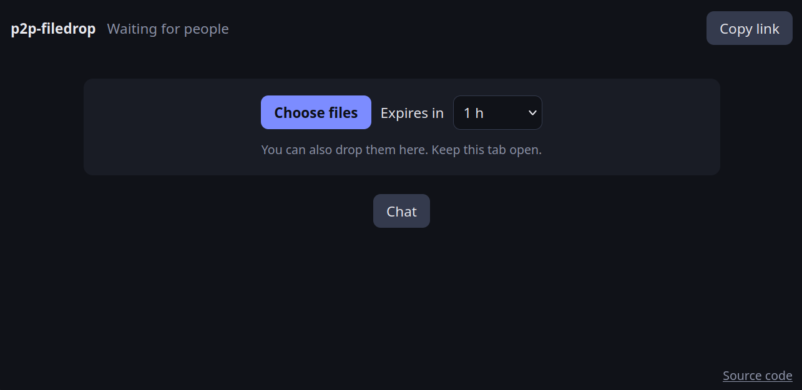

# p2p-filedrop

Send files and chat directly between browsers, using a link.

Try it: https://franciscocarloserra.github.io/p2p-filedrop/

Open the page to create a room, copy the link, send it. Whoever opens it asks to enter and the creator accepts or rejects them. Shared files expire after 1 h unless you pick another time, and also vanish when you close the tab.

## How it connects

There is no backend of ours, but connecting relies on third parties:

1. GitHub Pages serves the static page.
2. Browsers find each other through [Trystero](https://github.com/dmotz/trystero) over public Nostr relays (`nos.lol`, `relay.primal.net`, `nostr.mom`). The relays only carry the WebRTC connection setup, encrypted with the link's secret.
3. STUN servers from Google and Cloudflare tell each browser its public address.
4. Files and chat then go directly between browsers over WebRTC, encrypted end to end by the browser.

## Run

Any static server works, over HTTPS or on localhost:

    python3 -m http.server 7810

Tests (Node 20+, no dependencies): `node test.mjs`

## What protects you

- The link's secret and the creator's public key live in the URL fragment, which browsers don't send to servers.
- Only people the creator signed in receive anything. Each member verifies that signature itself. Those proofs are tied to the DTLS fingerprints of each connection, so they can't be forwarded.
- Keys and your name are in `sessionStorage`, so they end with the tab. Chat is memory only, and late joiners get no history.
- Everything a peer sends is validated in `security.js` and only reaches the page as text.
- The CSP in `index.html` allows only this site's own scripts and the three signaling relays.

## Limits

- Anyone holding the link can ask to enter, and names are self-chosen. Before accepting, confirm the code on your screen with that person through another channel.
- Peers see each other's IP address. Relays see that a room exists and the IPs connecting to it, not its content.
- STUN servers from Google and Cloudflare see your IP too. The CSP can't restrict WebRTC traffic.
- There is no TURN, so some strict networks won't connect.
- Expiry is enforced by the sharer's browser. Anyone who already downloaded a file keeps it.
- `vendor/trystero-nostr.mjs` is a minified bundle you can't audit by reading it. `test.mjs` pins its hash.
- Browsers without `showSaveFilePicker` keep incoming files in memory, so large files can fail there.
- A transfer that gets interrupted starts over from zero.
